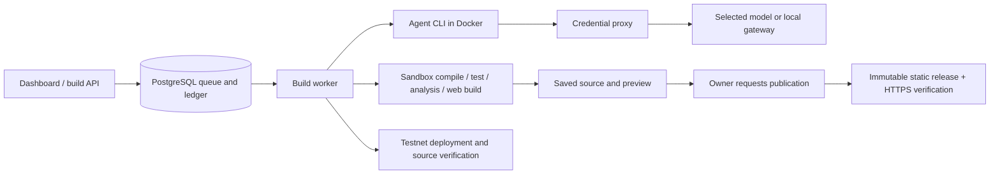

# Builder architecture

## Lifecycle

`lib/build/create.ts` accepts work and binds owner, selected provider/credential version and billing mode. Credits remain an append-only ledger. Worker-mode jobs are claimed under `lib/build/durable/`; ownership, leases, checkpoints and effect records prevent stale workers from publishing or replaying a deployment. The SSE console reads persisted events rather than controlling the lifetime of execution.

`lib/build/cli-builder.ts` runs needs analysis, builds prompt context, prepares a workspace, invokes the agent and independently compiles/tests/analyzes its output. The model cannot establish that a build passed by saying so. `lib/build/types.ts` defines the shared input, events and reports. `lib/build/completion.ts` enforces completion evidence. Cancellation must reach child processes, tool containers and privileged publishing helpers.

Generated applications use the image-owned foundation in `docker/webapp-template`. `prepare.mjs`, `build.mjs` and `lib/build/web.ts` enforce that foundation and compile static output. Changes to installed dependencies require rebuilding/versioning the agent image.

The platform owns signing/deployment outside model-authored execution. `lib/build/deploy.ts`, `deployment-target.ts` and the durable effect journal select the intended artifact and reconcile broadcasts. `lib/build/verify.ts` records explorer verification separately. Mainnet actions are gated; changing a prompt does not enable a chain.

`lib/hosting/drafts.ts` creates previews. `publications.ts` queues explicit publication; `publish.ts` copies immutable static releases, switches the `current` link and checks the HTTPS result. Failure retains the previous release.

## Trust boundaries

- Models and attachments are untrusted input. Generated code runs only in the sandbox.
- Provider keys stay in the server credential proxy or the user's gateway, not the generated workspace. Hosted encryption protects storage, not against the operator.
- Compiler/test tool containers have network disabled. Agent transport uses a constrained proxy and scoped authorization.
- Database ownership and execution-selection checks remain server-side; browser flags do not authorize deployment or expenditure.
- Preview documents have a separate sandbox/CSP policy. User apps should use a separate domain and never share platform cookies.
- Secrets, workspaces, logs, screenshots and database backups are operational data, not source-control assets.

## Extension boundaries today

There is a shared `Builder.run(input): AsyncIterable<BuildEvent>` seam, but there is no runtime-discovered chain-plugin system. The EVM implementation is distributed across prompts, schema, UI, wallets, toolchains and deployment. Adding a chain requires coordinated changes described in the extension guides. Preserve the queue, cancellation, owner binding and evidence checks while extracting reusable adapters.

Registry/Markets/Watch are optional companion services. Their EVM indexing assumptions do not automatically become valid when the builder gains a non-EVM backend. MCP currently exposes registry reads and scoped account webhook operations; it is not an unrestricted remote shell or build/deploy agent.
