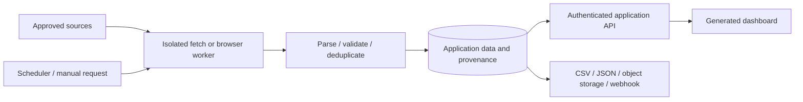

# Build data collection and automation applications

This is an extension recipe. Fletch already supplies project generation, a queue, sandbox patterns, previews and static publishing. It does not yet supply a general-purpose scraper service, browser fleet, recurring task scheduler or arbitrary generated backend hosting.

## Suggested architecture

The long-running collector belongs to the generated application's runtime, separate from the short-lived builder sandbox. Treat building the collector and operating the collector as different jobs.

## Implement in small steps

1. Define a source configuration and output schema: allowed URLs, fields, pagination, maximum pages/bytes, cadence, timezone and retention. Begin with a single deterministic local fixture.
2. Add a fetch connector; add a browser connector only where rendering is needed. Run the browser in a dedicated unprivileged container with bounded memory, processes, time and downloads. Keep browser profiles and session cookies out of source exports.
3. Restrict outbound destinations and recheck redirects/resolved addresses. Do not allow user-supplied URLs to reach the platform database, loopback, metadata endpoints or private services. Apply per-source concurrency and retry limits. Access sources only with the permissions available to the operator.
4. Parse into typed records, normalize values and deduplicate with a stable source key. Detect empty/blocked pages and changed schemas. Store source URL, observed time, parser version and validation failures so a successful request cannot hide bad extraction.
5. Add an application-owned scheduler/queue with leases, cancellation, bounded retries and resumable cursors. Use idempotent writes so a worker restart does not duplicate records or notifications. Do not insert arbitrary customer jobs into the builder's internal database tables without a reviewed adapter.
6. Provide an API and generated dashboard for run status, sample results, diffs, errors and exports. Keep scheduling and credentials server-side; a static site cannot reliably execute scheduled collection.
7. Add delivery adapters for CSV, JSON, object storage, webhooks or a restricted database role. Bind each destination to its owner and validate outbound addresses. Test delivery retry/deduplication and failed-destination recovery.

## Where to reuse the repository

Use `lib/build/durable/` as a reference for ownership and recovery, `lib/agent/sandbox.ts` for execution boundaries, and `lib/watch/` for bounded delivery patterns. These are implementation references, not a ready-made public scraping API. Extract shared primitives deliberately rather than coupling application jobs to credit, chain or build-specific tables.

Add any new agent-visible tool through the [tool guide](providers-and-tools.md). A provider/API connector receives scoped credentials through trusted transport, not a plaintext key in a prompt. Design the generated frontend using the [template guide](web.md), and provision its backend using a new server runtime adapter.

Test layout changes, bad encodings, timeouts, rate limits, pagination loops, duplicate records, partial runs, DNS/redirect changes and destination failures. Use synthetic HTML/JSON fixtures in tests. Keep real captures, session data and personal records outside the repository.
